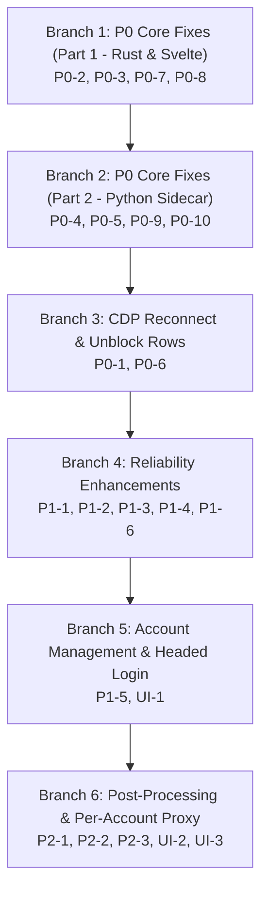

# VideoFlow Desktop — Danh mục Tính năng Chưa có & Cần bổ sung (v1.5.0+)

> **Cập nhật:** 19/11/2026 (sau bản phát hành v1.4.1).  
> **Cơ sở đối chiếu:** Toàn bộ source code hiện tại của VideoFlow (`videoflow-app`) + Phân tích kỹ thuật WDM Muse Video 1.4.0.  
> **Mục tiêu thực tế:** Phục vụ cấu hình 1–2 tài khoản Muse, chạy tuần tự trên IP Việt Nam, ưu tiên tuyệt đối sự ổn định, tự hồi phục khi lỗi và tự động hóa khép kín.

---

## 0. Quy ước triển khai & Tiêu chuẩn nghiệm thu (Gate Checks)

- **Cơ sở mã nguồn:** Nhánh `main` @ `c22f6ea` (v1.4.1 sạch).
- **Quy trình Git:** Mỗi mục/nhóm triển khai trên branch riêng (`fix/...` hoặc `feat/...`), rebase sạch lên `main` trước khi tích hợp.
- **Tiêu chuẩn nghiệm thu sau mỗi branch:**
  - Rust Backend: `cargo test` pass 100%.
  - Python Sidecar: `pytest videoflow-app/sidecar/tests` pass 100% (bổ sung test case cho parser ngày, pool quota, failover CDP, row_key).
  - Frontend Svelte: `npm run build` và `npx svelte-check` đạt **0 error, 0 warning nghiêm trọng**.
- **Nguyên tắc bảo toàn:**
  - Không phá vỡ định dạng `prompts.csv` hiện hành (chỉ thêm cột tùy chọn `noi_canh` cho P2-1, thiếu cột coi như 0).
  - Không sửa logic `.no_proxy()` trên các kết nối localhost Rust $\rightarrow$ Sidecar.
  - Tận dụng tối đa các hàm và mấu nối (hooks) đã có sẵn trong codebase, không viết code dư thừa.

---

## 1. Bảng phân loại hiện trạng: Đã có vs Chưa có vs Đang lỗi

| Nhóm | Mã mục | Hạng mục | Trạng thái trong v1.4.1 | Nền tảng / Mấu nối đã có sẵn | Việc cần làm để bổ sung / sửa lỗi |
|:---|:---|:---|:---:|:---|:---|
| **P0** | **P0-1** | CDP Reconnect & Tự khởi động lại trình duyệt | ❌ **CHƯA CÓ** | `_kill_stale_browsers` trong `chromium.py` | Bọc `CDPError`, kill sạch browser, dọn lock, giải phóng port và reconnect khi Edge/Chrome chết. |
| **P0** | **P0-2** | Chạy riêng dòng đúng 1 dòng (không chạy cả ảnh) | ⚠️ **ĐANG LỖI** | Biến `key_of_row` đã tính sẵn trong `commands.rs` | Sửa `commands.rs:1228, 1300` truyền `vec![key_of_row]` thay vì `vec![row.anh_tham_chieu]`. |
| **P0** | **P0-3** | Thumbnail ảnh gốc bị lỗi 404 & báo thiếu ảnh | ⚠️ **ĐANG LỖI** | Hàm `projectFileUrl` trong frontend | Sửa `Rows.svelte:1276, 1504` dùng `image_name` thay vì `row_key` (vốn chứa `#hash`). |
| **P0** | **P0-4** | Quota "Sep 30" khóa tài khoản vĩnh viễn | ⚠️ **ĐANG LỖI** | `_reset_deadline` trong `model.py` | Thêm format `%b %d` và sửa `quota_exhausted()` thành fail-open khi không parse được ngày. |
| **P0** | **P0-5** | PATCH cookie giữ nguyên hạn cũ của cookie bị ghi đè | ⚠️ **ĐANG LỖI** | Endpoint `/admin/accounts/{id}` | Xóa `cookie_expires` của cookie cũ khi cập nhật giá trị mới cùng tên trong `admin.py`. |
| **P0** | **P0-6** | Khóa cứng hàng loạt dòng khi gặp lỗi tạm thời | ⚠️ **ĐANG KHÓA CỨNG** | Cờ `count_toward_limit` có sẵn ở `engine.rs:382` | Xóa guard `MAX_ATTEMPTS_REACHED`; không tính lỗi tạm thời vào trần 3 lần; thêm trạng thái CSV `Lỗi tạm thời`. |
| **P0** | **P0-7** | Kẹt retry 7.5 phút khi Muse từ chối prompt | ⚠️ **ĐANG LỖI** | Phân loại HTTP trong `adapters.rs` | Phân loại `upstream_refused` (502) thành `ApiFailKind::NghiepVu` để dừng ngay, không retry 3 lần. |
| **P0** | **P0-8** | Đổi tên ảnh (Remap) làm mất hash key trong SQLite | ⚠️ **ĐANG LỖI** | SQLite jobs table | Tính lại `actual_key` có hash đầy đủ khi cập nhật SQLite jobs trong `commands.rs:1543-1561`. |
| **P0** | **P0-9** | Lệch OS User-Agent (Linux x86_64 vs Windows) | ⚠️ **ĐANG LỖI** | `upstream/muse.py` | Chuẩn hóa User-Agent sang Windows NT 10.0 để khớp trình duyệt thật, tránh Cloudflare flag. |
| **P0** | **P0-10**| Dọn dẹp tiến trình bỏ sót `chrome.exe` | ⚠️ **ĐANG LỖI** | WMI filter trong `chromium.py` & Rust | Mở rộng bộ lọc tiến trình để kill cả `msedge.exe` lẫn `chrome.exe`. |
| **P1** | **P1-1** | Kiểm tra toàn vẹn file tải về (.partial + FFmpeg) | ❌ **CHƯA CÓ** | `fetch_as_base64` trong `dom.py` | Ghi `.partial` $\rightarrow$ kiểm tra magic bytes $\rightarrow$ FFmpeg decode thử $\rightarrow$ rename chính thức. |
| **P1** | **P1-2** | Chờ video mount thẻ trước khi tải (Poll 6s) | ❌ **CHƯA CÓ** | DOM scroll trong `dom.py` | Poll tối đa 6s chờ `<video>` có `src` sau khi cuộn trang, tránh tải nhầm video cũ. |
| **P1** | **P1-3** | Tương quan kết quả bằng snapshot URL attachment | ❌ **CHƯA CÓ** | Logic scan attachments trong `driver.py` | Chụp `set(src)` trước khi gửi prompt; chỉ nhận URL mới phát sinh + đúng loại media. |
| **P1** | **P1-4** | Nhận diện Muse khóa tạo video (`video_locked`) | ❌ **CHƯA CÓ** | Pool cooldown logic | Bắt câu phản hồi khóa video $\rightarrow$ gán trạng thái `video_locked`, dừng batch, bật alert. |
| **P1-5** | Mở trình duyệt có giao diện để Login / Xem kết quả | ❌ **CHƯA CÓ** | Bộ lọc cookies/headers trong `driver.py` | Endpoint mở Chrome/Edge headed riêng; tự động bắt cookie/JWT/headers lưu vào cấu hình. |
| **P1-6** | Chờ upload ảnh tham chiếu xong mới bấm Enter | ❌ **CHƯA CÓ** | `_attach` trong `driver.py` | Poll chờ `[role=progressbar]` / `[aria-busy=true]` biến mất trước khi Send (timeout 45s). |
| **P2** | **P2-1** | Nối cảnh liên tục bằng frame cuối video trước | ❌ **CHƯA CÓ** | Quy trình B3 trong `engine.rs` | Cột CSV `noi_canh`: FFmpeg trích frame cuối (`-sseof -0.5`) làm ảnh đầu vào cảnh kế tiếp (kèm fail-safe). |
| **P2** | **P2-2** | Tự động ghép nối video sau batch (Auto-Merge) | ❌ **CHƯA CÓ** | Sự kiện kết thúc batch trong `engine.rs` | Tùy chọn concat FFmpeg (chuẩn hóa FPS/res trước khi ghép) ra 1 file duy nhất sau batch. |
| **P2** | **P2-3** | Proxy riêng từng tài khoản kèm profile độc lập | ❌ **CHƯA CÓ** | Cấu hình proxy chung trong sidecar | Quản lý dict các BrowserDriver riêng biệt; mỗi tài khoản 1 proxy + 1 profile riêng. |
| **UI** | **UI-1** | Màn hình / Tab "Tài khoản" riêng trên Sidebar | ❌ **CHƯA CÓ** | CRUD accounts API + Icons SVG có sẵn | Tách riêng tab Tài khoản trên thanh điều hướng; gom đủ nút Đăng nhập, Xem web, Proxy, Quota. |
| **UI** | **UI-2** | Statusbar IP/Node & Banner cảnh báo video lock | ❌ **CHƯA CÓ** | Footer statusbar 28px có sẵn | Thêm section IP/Proxy trên statusbar; thêm banner màu cam/đỏ trên đỉnh khi tài khoản bị khóa video. |
| **UI** | **UI-3** | Modal xem video lớn trong màn Dòng việc | ❌ **CHƯA CÓ** | `Modal.svelte` có sẵn (dùng cho ảnh) | Dblclick video $\rightarrow$ mở modal lớn tỉ lệ 9:16 kèm prompt ảnh, prompt video và metadata. |

---

## 2. Chi tiết kỹ thuật các hạng mục cần bổ sung

### 2.1. Nhóm P0 — Ổn định lõi & Sửa lỗi chặn thực thi

#### [P0-1] CDP Reconnect & Tự phục hồi trình duyệt
* **Hiện trạng v1.4.1:** `driver.py:143` chỉ tạo `CDPSession` 1 lần duy nhất lúc khởi động (`startup()`). Nếu Edge/Chrome bị tắt, crash hoặc đứt kết nối, biến `self._browser.closed = True`. Toàn bộ các request tiếp theo văng lỗi `500 CDPError: cdp connection closed` liên tục. Hàm `gateway._run` chỉ bắt `except UpstreamError:`, bỏ lọt `CDPError` (kế thừa `RuntimeError`).
* **Vị trí sửa:**
  - `sidecar/muse2api/drivers/browser/driver.py` (trong `_context`, `_checkout`, `_open_tab`).
  - `sidecar/muse2api/services/gateway.py` (trong `_run`).
  - `sidecar/muse2api/drivers/browser/chromium.py` (`_kill_stale_browsers`).
* **Giải pháp thực hiện:**
  1. Khi bắt gặp `CDPError` hoặc mất kết nối CDP:
     - Gọi hàm dọn dẹp `_kill_stale_browsers` để đóng triệt để tiến trình cũ.
     - Xóa các file khóa `SingletonLock`, `SingletonCookie`, `DevToolsActivePort` trong thư mục profile.
     - Chờ cổng 19210 giải phóng (poll 200ms, tối đa 10s).
     - Xóa sạch `self._tabs.clear()` và `self._contexts.clear()`.
     - Tự động gọi `startup()` để khởi động lại tiến trình trình duyệt mới và kết nối lại WebSocket.
  2. Bọc `CDPError` trong `gateway._run` như một lỗi có thể thử lại (`retryable = True`) để kích hoạt 1 lần retry tự động.
  3. Cập nhật `GET /admin/status` trả thêm cờ `browser_alive: bool` để giao diện phản ánh chính xác trạng thái thực của trình duyệt.
* **Nghiệm thu:** Tắt nóng tiến trình Edge qua Task Manager $\rightarrow$ request kế tiếp tự khởi động lại Edge thành công trong 1 lần thử; log ghi rõ browser exit/recovery; `pytest` pass.

#### [P0-2] Chạy riêng dòng đúng 1 dòng (Sửa lỗi chạy chùm)
* **Hiện trạng v1.4.1:** Trong `commands.rs:1228` (`run_row`) và `:1300` (`rerun_row_step`), mã nguồn đang truyền `vec![row.anh_tham_chieu.clone()]` vào danh sách `row_keys`. Trong khi đó `engine.rs:575` chấp nhận cả so khớp theo `row_key` lẫn tên ảnh `image`. Khi 1 ảnh được dùng cho nhiều dòng CSV, app sẽ chạy toàn bộ các dòng đó thay vì chỉ chạy dòng người dùng yêu cầu.
* **Vị trí sửa:** `videoflow-app/src-tauri/src/commands.rs`.
* **Giải pháp thực hiện:** Thay `vec![row.anh_tham_chieu.clone()]` bằng `vec![key_of_row]`. Biến `key_of_row` đã được tính toán chính xác ngay phía trên (bao gồm cả hash dòng). Giữ nguyên cơ chế so khớp tên ảnh trong `engine.rs` cho các lệnh chạy theo ảnh khác.
* **Nghiệm thu:** Dự án có 1 ảnh dùng cho 3 dòng $\rightarrow$ bấm "Chạy riêng dòng" hoặc "Chạy lại bước" chỉ chạy đúng 1 dòng được chọn; `cargo test` pass.

#### [P0-3] Sửa lỗi 404 Thumbnail ảnh gốc
* **Hiện trạng v1.4.1:** `Rows.svelte:1276` và `:1504` đang gọi `projectFileUrl("input", r.row_key)` để lấy đường dẫn thumbnail. Tuy nhiên, `row_key` là định danh nội bộ có gắn `#<hash>` (ví dụ `anh1.png#a1b2c3d4`), file thật trên đĩa chỉ là `anh1.png`. Hậu quả là request asset trả về 404 và UI hiển thị cảnh báo sai "Thiếu ảnh gốc".
* **Vị trí sửa:** `videoflow-app/src/screens/Rows.svelte` tại các dòng 1276, 1504, 1705 và 1836.
* **Giải pháp thực hiện:** Thay tham số `r.row_key` thành `r.image_name` khi gọi `projectFileUrl` và khi render tên file trên giao diện.
* **Nghiệm thu:** Mọi dòng trên màn hình Dòng việc hiển thị thumbnail ảnh gốc chính xác; không còn báo "Thiếu ảnh gốc" vô cớ; `npm run build` và `svelte-check` pass.

#### [P0-4] Sửa kẹt Quota ngày "Sep 30" (Fail-open)
* **Hiện trạng v1.4.1:** Muse trả về thời điểm reset quota dạng text như `"Sep 30"`. Trong `model.py:122`, hàm `_reset_deadline` thiếu format `%b %d`. Đồng thời tại dòng 66: `return reset_in is None or reset_in > 0` lại trả về `True` khi `reset_in` là `None` (không parse được), dẫn đến tài khoản đạt 100% quota bị khóa vĩnh viễn không bao giờ được mở lại.
* **Vị trí sửa:** `sidecar/muse2api/accounts/model.py`.
* **Giải pháp thực hiện:**
  1. Thêm bộ parse format `%b %d`: tính theo lần xuất hiện sắp tới của ngày đó (nếu ngày đã qua trong năm nay thì lấy năm tiếp theo).
  2. Sửa hàm `quota_exhausted()` thành cơ chế fail-open: nếu `reset_in is None` thì `return False` (không chặn oan tài khoản của người dùng).
* **Nghiệm thu:** Tài khoản 100% quota có chuỗi reset dạng "Sep 30" tự động giải phóng sau ngày reset; parse lỗi không bị kẹt cứng; bổ sung unit test case; `pytest` pass.

#### [P0-5] PATCH cookie xóa đúng `cookie_expires` cũ
* **Hiện trạng v1.4.1:** Trong `admin.py:164-167`, khi nhận payload PATCH cập nhật cookie, code kiểm tra `if name in acc.cookies:` thì giữ lại `cookie_expires`. Điều này khiến cho việc cập nhật cookie mới cùng tên vẫn bị giữ nguyên thời điểm hết hạn của cookie cũ đã chết.
* **Vị trí sửa:** `sidecar/muse2api/api/routes/admin.py`.
* **Giải pháp thực hiện:** Khi cookie có tên nằm trong payload cập nhật thì phải xóa `cookie_expires` tương ứng; chỉ giữ lại expiry của các cookie không bị đụng tới.
* **Nghiệm thu:** PATCH cookie giá trị mới $\rightarrow$ expiry cũ bị xóa bỏ hoàn toàn; bổ sung unit test; `pytest` pass.

#### [P0-6] Bỏ khóa cứng sau lỗi (Dòng lỗi luôn chạy lại được)
* **Hiện trạng v1.4.1:** `commands.rs:1209-1218` và `engine.rs:621-627` đặt guard `MAX_ATTEMPTS_REACHED`. Khi một dòng bị lỗi 3 lần (kể cả lỗi tạm thời như đứt mạng, 500 CDP), hệ thống khóa cứng dòng đó. Chạy batch sẽ âm thầm bỏ qua, bấm "Chạy riêng dòng" bị chặn báo lỗi. Nút "Đặt lại trạng thái" lại không hoạt động với các job key cũ (legacy).
* **Vị trí sửa:**
  - `videoflow-app/src-tauri/src/commands.rs` (`run_row`, `reset_row_status_at`).
  - `videoflow-app/src-tauri/src/engine.rs` (`plan_row`).
  - `videoflow-app/src-tauri/src/prompts_csv.rs`.
* **Giải pháp thực hiện:**
  1. Xóa bỏ hoàn toàn guard `MAX_ATTEMPTS_REACHED` trong `run_row` và `plan_row`. Biến đếm số lần lỗi chỉ dùng để hiển thị và cảnh báo.
  2. Phân loại lỗi qua hàm `is_transient_error`: Các lỗi tạm thời (5xx, CDP closed, timeout, 429) gọi `record_attempt(..., count_toward_limit = false)` (cờ này đã có sẵn ở `engine.rs:382`).
  3. Bổ sung trạng thái CSV `Lỗi tạm thời` phân biệt với `Lỗi` (lỗi vi phạm nội dung).
  4. Sửa `reset_row_status_at` để fallback tìm job theo legacy key, đảm bảo reset luôn có tác dụng.
* **Nghiệm thu:** Dòng bị lỗi 3 lần do mạng/CDP vẫn có thể bấm "Chạy riêng dòng" để chạy lại ngay mà không cần sửa prompt; `cargo test` pass.

#### [P0-7] Bắt lỗi `UpstreamRefused` thành Lỗi nghiệp vụ
* **Hiện trạng v1.4.1:** Khi câu prompt vi phạm chính sách của Muse, sidecar trả về `UpstreamRefused` (HTTP 502). Trong `adapters.rs:221`, hàm `classify_http` gom toàn bộ dải `500..=599` thành `ApiFailKind::TamThoi`. Engine tự động retry 3 lần với backoff (30s $\rightarrow$ 2m $\rightarrow$ 5m = 7.5 phút) vô ích, làm kẹt toàn bộ tiến trình batch.
* **Vị trí sửa:** `videoflow-app/src-tauri/src/adapters.rs` (hàm `classify_http`).
* **Giải pháp thực hiện:** Bắt riêng error code `"upstream_refused"` hoặc body chứa chỉ báo từ chối chính sách, phân loại thành `ApiFailKind::NghiepVu`. Dòng này sẽ dừng ngay lập tức, không retry.
* **Nghiệm thu:** Prompt vi phạm chính sách dừng ngay sau lần thử đầu tiên kèm thông báo rõ ràng; `cargo test` pass.

#### [P0-8] Sửa `remap_reference_image` giữ nguyên hash dòng
* **Hiện trạng v1.4.1:** Khi đổi tên ảnh tham chiếu, `commands.rs:1543-1561` cập nhật bảng `jobs` trong SQLite bằng biến `trimmed_new` (chỉ có tên ảnh trần). Điều này phá hỏng cấu trúc `row_key` chứa hash, khiến hàm `build_row_detail_at` không còn tìm thấy thông tin job cũ.
* **Vị trí sửa:** `videoflow-app/src-tauri/src/commands.rs`.
* **Giải pháp thực hiện:** Tính toán lại `actual_key` đầy đủ (bao gồm cả hash dòng) trước khi thực hiện UPDATE trong SQLite và cập nhật memory cache.
* **Nghiệm thu:** Đổi tên ảnh tham chiếu $\rightarrow$ chi tiết dòng và lịch sử chạy vẫn liên kết chính xác; `cargo test` pass.

#### [P0-9] Chuẩn hóa User-Agent sang Windows NT
* **Hiện trạng v1.4.1:** `sidecar/muse2api/upstream/muse.py:33` đang hardcode User-Agent của Linux x86_64 (`Linux; Android...` hoặc Linux Desktop) cho các request REST `/api/session`, trong khi Chromium chạy trên máy người dùng gửi User-Agent Windows NT 10.0. Sự lệch pha hệ điều hành này dễ bị Cloudflare và Muse gắn cờ rủi ro gian lận.
* **Vị trí sửa:** `sidecar/muse2api/upstream/muse.py`.
* **Giải pháp thực hiện:** Đổi User-Agent mặc định sang chuỗi Windows NT 10.0 đồng nhất với trình duyệt thật: `Mozilla/5.0 (Windows NT 10.0; Win64; x64) AppleWebKit/537.36 (KHTML, like Gecko) Chrome/131.0.0.0 Safari/537.36`.
* **Nghiệm thu:** User-Agent giữa REST API và CDP hoàn toàn đồng nhất; `pytest` pass.

#### [P0-10] Mở rộng bộ lọc dọn dẹp tiến trình cho `chrome.exe`
* **Hiện trạng v1.4.1:** Cả `muse_sidecar.rs:447` và `chromium.py:63` đang hardcode bộ lọc `Name='msedge.exe'`. Nếu người dùng cấu hình sử dụng Google Chrome làm trình duyệt chạy headless, các tiến trình Chrome mồ côi sẽ không được dọn dẹp khi app tắt hoặc restart.
* **Vị trí sửa:** `src-tauri/src/muse_sidecar.rs` và `sidecar/muse2api/drivers/browser/chromium.py`.
* **Giải pháp thực hiện:** Mở rộng câu lệnh lọc tiến trình để bắt cả `msedge.exe` VÀ `chrome.exe` có cờ `--remote-debugging-port=19210`.
* **Nghiệm thu:** Dọn dẹp sạch sẽ cả tiến trình Edge và Chrome mồ côi khi khởi động và thoát app.

---

### 2.2. Nhóm P1 — Độ tin cậy sinh video & Quản lý tài khoản

#### [P1-1] Kiểm tra toàn vẹn file tải về (.partial + Decode verify)
* **Hiện trạng v1.4.1:** Khi nhận dữ liệu base64 từ trình duyệt, sidecar ghi trực tiếp ra file đích. Nếu file tải về dở dang, bị rỗng hoặc lỗi mạng giữa chừng, app vẫn ghi nhận hoàn thành. Video hỏng không xem được nhưng dòng CSV vẫn đánh dấu Thành công.
* **Vị trí sửa:** `sidecar/muse2api/drivers/browser/dom.py` (`fetch_as_base64`) và `driver.py` (sau khi nhận base64).
* **Giải pháp thực hiện:**
  1. Ghi file tạm có đuôi `.partial`.
  2. Kiểm tra magic bytes ở đầu file: PNG (`89 50 4E 47`), JPEG (`FF D8 FF`), WebP (`52 49 46 46`), MP4 (`00 00 00 ... ftyp`).
  3. Với file video: chạy lệnh FFmpeg giải mã thử toàn bộ luồng: `ffmpeg -v error -i file.partial -f null -`.
  4. Nếu giải mã thành công: đổi tên từ `.partial` sang tên file chính thức.
  5. Nếu lỗi: xóa file tạm, tính là 1 lần thử thất bại để kích hoạt retry tự động, tuyệt đối không lưu file rác vào thư mục dự án.
* **Nghiệm thu:** File lỗi tải về được phát hiện ngay lập tức; hệ thống tự động tải lại; không bao giờ lưu video 0 byte hoặc video hỏng vào output.

#### [P1-2] Chờ video mount thẻ trước khi tải (Timeout 6s)
* **Hiện trạng v1.4.1:** Sau khi cuộn trang xuống đáy bằng JavaScript, code trích xuất thẻ video ngay lập tức. Trên mạng chậm hoặc máy yếu, thẻ `<video>` cần 0.5s – 2s để React/Hatch mount thuộc tính `src`. Việc trích xuất ngay dẫn đến việc lấy nhầm URL của video ở lượt chạy trước đó.
* **Vị trí sửa:** `sidecar/muse2api/drivers/browser/dom.py` và luồng tải trong `driver.py`.
* **Giải pháp thực hiện:** Sau khi cuộn trang xuống đáy, thực hiện vòng lặp poll ngắn (mỗi 100ms) chờ thẻ `<video>` xuất hiện thuộc tính `src` (hoặc wrapper cha có `data-hatch-video-src`). Thời gian chờ tối đa 6 giây. Nếu quá 6s vẫn chưa mount thì ghi log cảnh báo và tiếp tục với cơ chế fallback hiện tại.
* **Nghiệm thu:** Thẻ video mount trễ vẫn được bắt chính xác; loại bỏ hoàn toàn hiện tượng lưu nhầm video cũ của dòng trước.

#### [P1-3] Tương quan kết quả bản nhẹ (`set(src)`)
* **Hiện trạng v1.4.1:** App quét kết quả trên trang hội thoại dựa vào thứ tự xuất hiện cuối cùng. Nếu trong phiên chat có nhiều media cũ, việc so khớp dễ bị lệch nếu DOM cập nhật chậm.
* **Vị trí sửa:** `sidecar/muse2api/drivers/browser/driver.py` (hàm `_generate`).
* **Giải pháp thực hiện:**
  1. Ngay trước khi bấm nút Send prompt (`_send`), thu thập một tập hợp các URL media hiện có trên DOM: `existing_urls = set(src)`.
  2. Sau khi sinh xong, bộ lọc kết quả chỉ chấp nhận các attachment có URL **không nằm trong** `existing_urls` và có thuộc tính `kind` khớp chính xác với tác vụ đang sinh (ảnh hoặc video).
* **Nghiệm thu:** Hai lượt sinh liên tiếp trong cùng một phiên hội thoại không bao giờ nhận nhầm kết quả của nhau; `pytest` pass.

#### [P1-4] Phát hiện Muse khóa tính năng tạo video (`video_locked`)
* **Hiện trạng v1.4.1:** Khi tài khoản Muse bị gắn cờ hạn chế hoặc lỗi vùng dẫn đến khóa tính năng video, Muse trả về câu thông báo dạng chữ trong khung chat ("Tính năng tạo video tạm thời không khả dụng..."). App không nhận diện được, tiếp tục chờ timeout 15 phút rồi retry vô ích 3 lần.
* **Vị trí sửa:** `driver.py` / `gateway.py` và trạng thái tài khoản trong `accounts/pool.py`.
* **Giải pháp thực hiện:**
  1. So khớp nội dung phản hồi văn bản của Muse với danh sách mẫu câu: *"tính năng tạo video không khả dụng"*, *"video không khả dụng"*, *"không thể tạo video"*, *"video generation is not available"*, *"unable to generate video"*.
  2. Chỉ kết luận khi không có video nào được tạo ra VÀ quá trình sinh đã kết thúc.
  3. Gán trạng thái tài khoản thành `video_locked` (tương tự như trạng thái `cooling`).
  4. Lập tức dừng toàn bộ các dòng đang chờ của tài khoản đó, không retry lặp lại, đồng thời đẩy sự kiện cảnh báo lên giao diện desktop.
* **Nghiệm thu:** Khi gặp câu thông báo khóa video từ Muse, batch dừng ngay lập tức; tài khoản hiển thị badge cảnh báo; tiết kiệm thời gian chờ.

#### [P1-5] Tự mở trình duyệt có giao diện để Đăng nhập & Thu hoạch token
* **Hiện trạng v1.4.1:** Người dùng phải tự mở Edge, bật DevTools (F12), tìm cookie thủ công rồi copy-paste vào ô cấu hình. Quy trình này phức tạp và dễ nhầm lẫn.
* **Vị trí sửa:**
  - Endpoint mới trên Sidecar: `POST /admin/accounts/{id}/open-login` và `POST /admin/accounts/{id}/open-view`.
  - Tauri commands mới trong `commands.rs` và `muse_sidecar.rs`.
* **Giải pháp thực hiện:**
  1. Nút **"Đăng nhập"**: Khi bấm, app tạm dừng phiên headless, mở một cửa sổ trình duyệt Edge/Chrome có giao diện (headed) với đúng thư mục profile riêng của tài khoản đó.
  2. Tự động gắn bộ lắng nghe mạng (network interceptor): Khi người dùng đăng nhập tài khoản Muse thành công trên web, app tự động bắt toàn bộ cookies, auth headers, token và JWT trong `localStorage`, lưu trực tiếp vào file cấu hình `accounts.json`.
  3. Khi người dùng đóng cửa sổ: Khởi động lại phiên headless với bộ token mới nhất vừa thu hoạch. Nút Đăng nhập sẽ bị khóa khi tài khoản đó đang chạy batch.
  4. Nút **"Xem trên web"**: Mở cửa sổ trình duyệt trỏ thẳng vào lịch sử hội thoại của tài khoản đó để người dùng kiểm tra kết quả trực quan.
* **Nghiệm thu:** Người dùng bấm nút $\rightarrow$ đăng nhập trên web 1 lần $\rightarrow$ app tự nhận tài khoản mà không cần thao tác qua DevTools.

#### [P1-6] Chờ upload ảnh tham chiếu xong mới bấm Enter
* **Hiện trạng v1.4.1:** `driver.py:429` trong hàm `_attach` chỉ sử dụng một lệnh chờ cố định `await asyncio.sleep(1.0)` rồi gọi `_send()`. Với file ảnh dung lượng lớn hoặc khi mạng chập chờn, Muse vẫn đang trong quá trình upload ảnh (hiện thanh tiến trình) thì app đã bấm Enter gửi prompt. Kết quả là video sinh ra không có ảnh tham chiếu, làm lãng phí quota và sai kịch bản.
* **Vị trí sửa:** `sidecar/muse2api/drivers/browser/driver.py`.
* **Giải pháp thực hiện:** Sau khi gắn file vào input, thêm vòng lặp poll kiểm tra các phần tử `[role=progressbar]` hoặc `[aria-busy=true]` trong vùng soạn thảo. Chỉ thực hiện bấm Enter khi thanh tiến trình đã biến mất hoàn toàn (timeout 45 giây). Nếu quá 45s mà chưa upload xong thì dừng lại và báo lỗi rõ ràng, không gửi prompt thiếu ảnh.
* **Nghiệm thu:** Đưa ảnh 4K/ảnh nặng vào chạy với mạng giả lập bóp băng thông $\rightarrow$ app luôn chờ ảnh gắn thành công vào khung chat mới bấm gửi.

---

### 2.3. Nhóm P2 — Trải nghiệm nâng cao & Hậu kỳ tự động

#### [P2-1] Nối cảnh liên tục bằng frame cuối (Scene Continuation)
* **Hiện trạng v1.4.1:** VideoFlow sinh từng video độc lập dựa trên ảnh tham chiếu tĩnh ban đầu. Không có cơ chế duy trì tính liên tục của nhân vật và bối cảnh qua nhiều cảnh quay liên tiếp.
* **Vị trí sửa:** `prompts_csv.rs` (bổ sung parser) và `engine.rs` (bước B3).
* **Giải pháp thực hiện:**
  1. Thêm cột tùy chọn `noi_canh` (giá trị 0 hoặc 1, mặc định là 0 nếu không có cột) vào file `prompts.csv`.
  2. Khi dòng hiện tại bật `noi_canh = 1`: Engine gọi lệnh FFmpeg trích xuất khung hình cuối cùng của video ở dòng liền trước:
     `ffmpeg -y -sseof -0.5 -i prev_video.mp4 -frames:v 1 last_frame.png`
  3. Sử dụng file `last_frame.png` này làm ảnh tham chiếu đầu vào cho cảnh quay hiện tại.
  4. **Cơ chế phòng vệ (Fail-safe):** Nếu video cảnh trước bị lỗi hoặc file bị xóa, hệ thống tự động quay về sử dụng ảnh tham chiếu gốc của chính cảnh đó và hiển thị cảnh báo vàng trên dòng, tuyệt đối không làm đứt gãy cả chuỗi batch.
* **Nghiệm thu:** Bật `noi_canh=1` cho chuỗi 3 cảnh $\rightarrow$ cảnh 2 và 3 giữ được tính liền mạch chuyển động và góc máy từ cảnh trước.

#### [P2-2] Tự động ghép nối video sau batch (Auto-Merge)
* **Hiện trạng v1.4.1:** Sau khi tạo xong hàng loạt video theo danh sách CSV, người dùng phải sử dụng phần mềm bên ngoài (CapCut, Premiere) để ghép các clip lại với nhau thành video hoàn chỉnh.
* **Vị trí sửa:** `settings.rs` và `engine.rs` (sự kiện kết thúc batch).
* **Giải pháp thực hiện:**
  1. Thêm tùy chọn `auto_merge: bool` (mặc định tắt) trong Cài đặt.
  2. Khi hoàn thành toàn bộ lượt chạy batch: Nếu tùy chọn bật, engine tự động lấy danh sách video thành phẩm theo đúng thứ tự dòng CSV.
  3. Chuẩn hóa video trước khi ghép: Đưa các clip về cùng độ phân giải (720x1280) và cùng FPS (scale/pad filter) để tránh lỗi mất tiếng, lệch khung hình.
  4. Sử dụng FFmpeg concat demuxer ghép nối nhanh; nếu clip nào không có audio thì tự động bù track âm thanh câm (`anullsrc`).
  5. Xuất ra file duy nhất: `video_out/<ten_du_an>_merged_<timestamp>.mp4`. Nếu merge lỗi, giữ nguyên toàn bộ các clip lẻ thành phẩm.
* **Nghiệm thu:** Bật Auto-Merge $\rightarrow$ kết thúc batch có ngay file video tổng hợp hoàn chỉnh, đúng thứ tự và không bị lỗi đồng bộ âm thanh.

#### [P2-3] Proxy riêng từng tài khoản kèm profile độc lập
* **Hiện trạng v1.4.1:** Sidecar chỉ hỗ trợ cấu hình 1 proxy chung (`browser_proxy`) cho toàn bộ hệ thống. Không thể phân chia mỗi tài khoản Muse chạy một IP mạng khác nhau để tránh bị dính cờ quét tài khoản hàng loạt.
* **Vị trí sửa:**
  - `sidecar/muse2api/config.py`, `pool.py`, `driver.py`, `chromium.py`.
  - Cấu trúc thư mục: `muse/profiles/<account_id>/`.
* **Giải pháp thực hiện:**
  1. Bổ sung trường `proxy: string | null` trong cấu hình từng tài khoản.
  2. Nâng cấp `driver.py` quản lý danh sách `dict[account_id, BrowserDriver]`. Mỗi tài khoản chạy một tiến trình Chromium riêng với cờ `--proxy-server` tương ứng và một thư mục profile riêng biệt hoàn toàn.
  3. Cơ chế fallback: Tài khoản không cấu hình proxy sẽ dùng proxy chung mặc định; nếu không có proxy chung thì kết nối trực tiếp.
  4. Toàn bộ logic CDP Reconnect (P0-1) và dọn dẹp tiến trình được cô lập theo từng driver của từng tài khoản.
* **Nghiệm thu:** 2 tài khoản chạy 2 proxy khác nhau $\rightarrow$ kiểm tra IP trên web cho kết quả 2 địa chỉ IP riêng biệt; tắt proxy của tài khoản này không ảnh hưởng đến tài khoản kia.

---

### 2.4. Nhóm Giao diện người dùng (UI)

#### [UI-1] Màn hình / Tab "Tài khoản" riêng trên Sidebar
* **Hiện trạng v1.4.1:** Danh sách tài khoản Muse bị chôn sâu bên trong tab "Endpoint video" của màn hình Cài đặt (`Settings.svelte:1511`), gây khó khăn cho việc theo dõi hạn mức quota và thao tác hàng ngày.
* **Vị trí sửa:**
  - `videoflow-app/src/App.svelte` (Sidebar điều hướng).
  - Tạo mới `src/screens/Accounts.svelte`.
  - Tạo mới component `src/lib/AccountCard.svelte`.
* **Giải pháp thực hiện:**
  1. Thêm mục điều hướng **"Tài khoản"** trên Sidebar (icon SVG `video-source` có sẵn trong `Icons.svelte`).
  2. Thiết kế màn hình `Accounts.svelte`: Form thêm tài khoản ở phía trên, danh sách thẻ tài khoản ở phía dưới.
  3. Thẻ tài khoản (`AccountCard.svelte`): Hiển thị tên/ID, trạng thái hoạt động, thanh hạn mức Quota, trường nhập Proxy riêng (P2-3), nút **"Đăng nhập"** (mở browser headed - P1-5), nút **"Xem trên web"** (P1-5), nút làm mới quota và nút xóa.
  4. Tại tab Endpoint video trong Cài đặt: Thu gọn thành một dòng tóm tắt thông tin ("2 tài khoản · 1 đang bật") kèm nút chuyển nhanh sang tab Tài khoản.
* **Nghiệm thu:** Truy cập và quản lý toàn bộ tài khoản ngay trên Sidebar; giao diện sạch sẽ, chuyên nghiệp, không dùng emoji; `svelte-check` đạt 0 lỗi.

#### [UI-2] Statusbar IP/Node & Banner cảnh báo video lock
* **Hiện trạng v1.4.1:** Thanh trạng thái dưới đáy màn hình (cao 28px) chỉ hiển thị tiến trình chung, không cho biết tài khoản đang chạy qua proxy hay IP nào. Khi tài khoản bị khóa tính năng video, không có cảnh báo trực quan cho người dùng.
* **Vị trí sửa:** `videoflow-app/src/App.svelte`.
* **Giải pháp thực hiện:**
  1. **Statusbar IP/Node:** Thêm section mới trên footer: hiển thị nhãn `IP: <host:port>` (nếu có proxy) hoặc `IP: trực tiếp` của tài khoản đang chạy tác vụ.
  2. **Banner khóa video:** Đặt một khung cảnh báo nổi ở đỉnh vùng làm việc (dưới thanh tiêu đề): *"Tài khoản [Tên] bị khóa tính năng video — [Đổi tài khoản]"*. Khi bấm nút "Đổi tài khoản", app tự động tạm dừng tài khoản đó và chuyển người dùng sang tab Tài khoản để kích hoạt tài khoản dự phòng khác.
* **Nghiệm thu:** Người dùng luôn nắm rõ IP đang kết nối; khi gặp sự cố khóa video, hệ thống cảnh báo tức thì và cung cấp lối tắt xử lý nhanh.

#### [UI-3] Modal xem video lớn trong màn Dòng việc
* **Hiện trạng v1.4.1:** Video chỉ phát trong một khung nhỏ ở góc chi tiết dòng hoặc màn hình so sánh. Hiện chỉ có modal Lightbox phóng to ảnh, chưa có modal phóng to video để kiểm tra kỹ lưỡng chất lượng thành phẩm.
* **Vị trí sửa:** `videoflow-app/src/screens/Rows.svelte` và `commands.rs` (`build_row_detail_at`).
* **Giải pháp thực hiện:**
  1. Tận dụng component `Modal.svelte` sẵn có, thiết lập kích thước rộng `880px`.
  2. Cho phép người dùng click đúp vào thumbnail video hoặc bấm icon phóng to trong thanh công cụ chi tiết dòng để mở Modal xem lớn.
  3. Nội dung modal gồm: Trình phát video chuẩn tỉ lệ 9:16 với đầy đủ nút điều khiển, thông tin tên file, thời lượng, độ phân giải, tài khoản đã sinh video, cùng 2 ô văn bản hiển thị nguyên văn "Prompt tạo ảnh" và "Prompt tạo video" cho phép copy nhanh.
* **Nghiệm thu:** Click đúp thumbnail $\rightarrow$ video mở lớn rõ nét kèm toàn bộ metadata và câu prompt; đóng mở mượt mà bằng phím Esc hoặc nút đóng; `svelte-check` pass.

---

## 3. Danh mục KHÔNG LÀM (Out of Scope)

Để tập trung nguồn lực và giữ cho ứng dụng gọn nhẹ, ổn định nhất, các mục sau đây **dứt khoát không thực hiện**:
1. **Không tích hợp hệ thống Mihomo / Clash Core phức tạp:** Quá cồng kềnh, tiêu tốn tài nguyên máy và không cần thiết với nhu cầu 1–2 tài khoản trên IP Việt Nam.
2. **Không mua proxy dân cư trả phí đắt đỏ:** Ưu tiên chạy trực tiếp IP nhà mạng VN hoặc dùng VPS IPv6 miễn phí/giá rẻ.
3. **Không dùng AI nối video (Muse-merge):** Làm tiêu tốn quota tài khoản và chất lượng ghép không kiểm soát được bằng thuật toán deterministic của FFmpeg.
4. **Không làm cascade tải file 6 nấc:** Các nấc click DOM modal hay nút download phụ rất dễ bị gãy khi Muse cập nhật giao diện web; chỉ dùng 2 nấc ổn định kết hợp xác thực toàn vẹn bằng FFmpeg (P1-1).
5. **Không chạy song song hàng chục luồng kiểu WDM:** Dễ bị Muse cắm cờ khóa tài khoản hàng loạt; giữ vững kiến trúc chạy tuần tự ổn định cho 1–2 tài khoản.

---

## 4. Kế hoạch triển khai theo từng Branch (Thứ tự tối ưu)

Quy trình triển khai chia làm 6 nhánh độc lập, nghiệm thu hoàn tất từng nhánh trước khi merge vào `main`:

### Chi tiết các bước:
1. **Branch 1 — `fix/p0-core-rust-frontend`:**
   - Sửa `P0-2` (Chạy riêng dòng đúng key).
   - Sửa `P0-3` (Thumbnail 404 image_name).
   - Sửa `P0-7` (UpstreamRefused phân loại thành NghiepVu).
   - Sửa `P0-8` (Remap SQLite hash key).
   - *Gate check:* `cargo test` & `npm run build && npx svelte-check`.
2. **Branch 2 — `fix/p0-core-sidecar`:**
   - Sửa `P0-4` (Format "Sep 30" & fail-open quota).
   - Sửa `P0-5` (PATCH cookie xóa expires cũ).
   - Sửa `P0-9` (Chuẩn hóa User-Agent Windows NT 10.0).
   - Sửa `P0-10` (Dọn dẹp cả msedge.exe và chrome.exe).
   - *Gate check:* `pytest videoflow-app/sidecar/tests`.
3. **Branch 3 — `feat/p0-cdp-recovery-unlock`:**
   - Thực hiện `P0-1` (Bọc CDPError, tự động dọn lock, giải phóng port, startup lại).
   - Thực hiện `P0-6` (Xóa bỏ MAX_ATTEMPTS_REACHED, phân loại lỗi tạm thời, mở khóa chạy lại).
   - *Gate check:* `cargo test` & `pytest`.
4. **Branch 4 — `feat/p1-generation-reliability`:**
   - Thực hiện `P1-1` (Ghi .partial, check magic bytes, verify decode FFmpeg).
   - Thực hiện `P1-2` (Poll 6s chờ thẻ video mount src).
   - Thực hiện `P1-3` (Tương quan URL media trước khi send).
   - Thực hiện `P1-4` (Nhận diện Muse khóa video, set trạng thái `video_locked`).
   - Thực hiện `P1-6` (Chờ progressbar upload ảnh biến mất trước khi Enter).
   - *Gate check:* `pytest` & `cargo test`.
5. **Branch 5 — `feat/p1-ui-account-management`:**
   - Thực hiện `P1-5` (Endpoints mở trình duyệt headed đăng nhập tay và tự thu hoạch token).
   - Thực hiện `UI-1` (Màn hình Tab "Tài khoản" riêng trên Sidebar, tạo `AccountCard.svelte`).
   - *Gate check:* `cargo test`, `pytest`, `npm run build`, `svelte-check`.
6. **Branch 6 — `feat/p2-advanced-pipeline`:**
   - Thực hiện `P2-1` (Cột CSV `noi_canh`, cắt last frame FFmpeg làm ảnh tham chiếu).
   - Thực hiện `P2-2` (Cờ Auto-Merge video sau batch, chuẩn hóa FPS/res trước khi concat).
   - Thực hiện `P2-3` (Proxy riêng từng tài khoản kèm thư mục profile riêng biệt).
   - Thực hiện `UI-2` (Statusbar IP/Node và banner nổi cảnh báo video lock).
   - Thực hiện `UI-3` (Modal xem video lớn dblclick kèm prompt và metadata).
   - *Gate check:* Toàn bộ gate checks (Rust, Python, Svelte) đạt 100% xanh.
